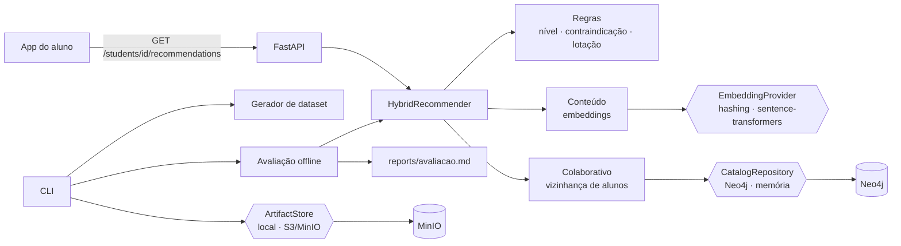

# lesson-recommender


Recomendador híbrido de aulas para alunos de estúdios de yoga e pilates, com **avaliação
offline como núcleo**. Combina embeddings de conteúdo, colaborativo em grafo (Neo4j) e regras
de negócio, e explica cada recomendação.

> Domínio fictício. Faz parte de um ecossistema de portfólio: os alunos e aulas vêm do SaaS de
> agendamento para estúdios (`saas-multitenant`).

## O problema

Num estúdio, o aluno costuma se prender a uma ou duas aulas da grade, enjoa e cancela o plano.
A grade tem dezenas de opções (Hatha às 7h, Pilates Aparelhos às 18h30, Yin Yoga aos sábados),
mas ninguém tem tempo de explorar. O recomendador responde, para cada aluno:

- **Quais aulas que você ainda não faz combinam com você?** Considera seus objetivos (postura,
  flexibilidade, redução do estresse...), as aulas que você já frequenta e o que alunos
  parecidos frequentam.
- **Sem riscos:** nunca sugere aula lotada, acima do seu nível ou contraindicada para uma
  restrição sua (gestação, lesão lombar, hipertensão...).
- **Com o porquê:** "Trabalha seus objetivos: postura", "Reservada por 4 alunos com histórico
  parecido com o seu".

E responde a pergunta que importa antes de ir para produção: **ele é melhor do que
simplesmente mostrar as aulas mais populares?** O [relatório de avaliação](reports/avaliacao.md)
mostra que sim, com intervalo de confiança.

| NDCG@10 (split temporal) | Aleatório | Popularidade | Só conteúdo | Só colaborativo | **Híbrido** |
|---|---:|---:|---:|---:|---:|
| Valor | 0,127 | 0,180 | 0,364 | 0,378 | **0,413** |

## Arquitetura

Hexagonal ([ADR 0001](docs/adr/0001-arquitetura-hexagonal-com-portas.md)). O núcleo depende só
de portas; Neo4j, embeddings e storage são adaptadores trocáveis por configuração.



Mais detalhes, fluxos e falhas: [docs/design-doc.md](docs/design-doc.md).

## Como rodar

Pré-requisitos: Python 3.12+ e, para o ambiente completo, Docker.

```bash
make install          # venv + dependências de desenvolvimento
make evaluate         # gera o dataset (seed 42) e regenera reports/avaliacao.md
make run              # API em http://localhost:8000 com repositório em memória
curl "http://localhost:8000/students/aluno-0007/recommendations?k=5"
```

Ambiente completo com Neo4j, MinIO e carga automática:

```bash
cp .env.example .env  # opcional: ajuste portas se houver conflito
make up               # perfil core: neo4j, minio, seed (carga + avaliação + publicação), api
make ps               # estado dos serviços
curl "http://localhost:8000/students/aluno-0007/recommendations?k=5"
make up-all           # + perfil observability: Jaeger (http://localhost:16686) e Prometheus (:9090)
make down             # para tudo (make clean também apaga volumes)
```

- Neo4j Browser: http://localhost:7474 (usuário `neo4j`, senha `dev-only-change-me`).
- Console do MinIO: http://localhost:9001 (artefatos em `runs/AAAA-MM-DD/`).
- Documentação interativa da API: http://localhost:8000/docs.

Exemplo de resposta (resumido):

```json
{
  "student_id": "aluno-0007",
  "k": 5,
  "weights": {"content": 0.3, "collaborative": 0.6, "popularity": 0.1},
  "items": [{
    "lesson": {"id": "aula-027", "title": "Hatha Yoga intermediário · 12:00", "schedule": "quarta 12:00", "seats_left": 12},
    "score": 0.852,
    "breakdown": {"content": 0.855, "collaborative": 0.887, "popularity": 0.7},
    "reasons": [
      "Trabalha seus objetivos: redução do estresse.",
      "Reservada por 4 alunos com histórico parecido com o seu.",
      "Nível intermediário compatível com o seu (avançado); quarta 12:00."
    ]
  }]
}
```

### Configuração

Tudo é configurado por variáveis `LR_*`, documentadas em [.env.example](.env.example). As
principais:

| Variável | Padrão | Efeito |
|---|---|---|
| `LR_REPOSITORY_BACKEND` | `memory` | `memory` (dataset JSON) ou `neo4j` |
| `LR_EMBEDDINGS_BACKEND` | `hashing` | `sentence-transformers` exige `pip install '.[sentence-transformers]'` |
| `LR_WEIGHT_CONTENT` / `_COLLABORATIVE` / `_POPULARITY` | 0,3 / 0,6 / 0,1 | Pesos do híbrido |
| `LR_NEIGHBORS` | 30 | Vizinhos no colaborativo |
| `LR_ARTIFACTS_BACKEND` | `local` | `s3` publica no MinIO ou S3 (`LR_S3_ENDPOINT_URL`) |

## Como testar

```bash
make lint typecheck   # ruff + mypy estrito (src e tests)
make test-unit        # testes de unidade, menos de 10 s, sem Docker
make test-integration # Neo4j real via testcontainers (pula sem Docker)
make test             # tudo
```

- **Métricas:** testadas com casos calculados à mão (`tests/unit/test_metrics.py`).
- **Paridade do colaborativo:** o teste de integração carrega um dataset gerado no Neo4j e
  exige que a consulta Cypher produza exatamente os mesmos scores da implementação de
  referência em Python.
- **Regras de negócio:** testadas caso a caso (lotação, nível, contraindicação, política).
- **API:** 404, 422, lista vazia, explicações e métricas Prometheus.
- **CI:** o pipeline regenera o relatório de avaliação e falha se ele divergir do commitado.

## Decisões principais

| ADR | Decisão |
|---|---|
| [0001](docs/adr/0001-arquitetura-hexagonal-com-portas.md) | Hexagonal com portas: a mesma lógica roda sobre memória (testes e avaliação) e sobre o Neo4j (API) |
| [0002](docs/adr/0002-porta-de-embeddings.md) | Embeddings por hashing determinístico no CI; sentence-transformers opcional por variável de ambiente |
| [0003](docs/adr/0003-neo4j-e-colaborativo-por-vizinhanca.md) | Neo4j e colaborativo user-based (Jaccard) em Cypher, com implementação de referência e teste de paridade |
| [0004](docs/adr/0004-protocolo-de-avaliacao-offline.md) | Split temporal global, relevante = descoberta, baselines e bootstrap pareado |
| [0005](docs/adr/0005-regras-de-negocio-como-filtros.md) | Regras de negócio como filtros duros; lotação desligada na avaliação offline |
| [0006](docs/adr/0006-dataset-sintetico-com-padroes-plantados.md) | Dataset sintético reprodutível com padrões plantados |
| [0007](docs/adr/0007-combinacao-hibrida-linear.md) | Combinação linear com normalização por pedido e pesos configuráveis |
| [0008](docs/adr/0008-artefatos-do-modelo-no-minio.md) | Artefatos do modelo (índice de embeddings e relatórios) no S3/MinIO atrás de uma porta |
| [0009](docs/adr/0009-ingestao-do-saas-por-api-v1.md) | Ingestão do SaaS por API v1 com credencial de serviço, ACL e um recomendador por tenant |

O núcleo, a métrica de avaliação, está explicado para entrevista em
[docs/roteiros/metrica-de-avaliacao.md](docs/roteiros/metrica-de-avaliacao.md).

## Integração com o SaaS

Com `LR_SAAS_API_URL` definido, a API lê aulas, alunos e reservas reais de cada estúdio pela
API v1 do SaaS e serve `GET /tenants/{tenant}/students/{id}/recommendations?k=`, protegido
pelo JWT do Keycloak (claim `tenant`), com isolamento por estúdio, aluno só vendo as próprias
recomendações e CORS para o front. Contrato, erros e variáveis em
[docs/integracao-saas.md](docs/integracao-saas.md).

## Observabilidade

- **Logs:** JSON em stdout, com `trace_id` e `span_id`.
- **Métricas:** Prometheus em `/metrics`. Requisições e latência por rota, recomendações por
  sinal dominante, pedidos sem resultado.
- **Traces:** OpenTelemetry, exportados por OTLP quando `LR_OTEL_EXPORTER_OTLP_ENDPOINT` está
  definido. `make up-all` sobe o Jaeger e o Prometheus já configurados.

Detalhes na seção 8 do design doc.

## Trade-offs

- **Hashing em vez de embeddings semânticos por padrão:** reprodutível e leve, mas sem
  sinônimos. A troca é uma variável de ambiente, e o impacto deve ser medido no relatório.
- **Colaborativo online por consulta Cypher:** simples e explicável. Com muitos alunos, o
  caminho é pré-computar vizinhos em lote.
- **Mundo sintético:** os números valem para este dataset. O que transfere para um estúdio real
  é o protocolo de avaliação.
- **Pesos ajustados na validação, não no teste:** a grade é avaliada num recorte interno ao
  treino (`evaluate --tune`). No teste o resultado ficou um pouco abaixo dos pesos a priori
  (NDCG@10 0.404 contra 0.413), dentro do ruído: o que vale é o procedimento, não o número.
- **A lotação vem da sincronização com o SaaS** (a cada 5 minutos), então pode estar
  defasada nesse intervalo.

## Próximos passos

1. Ajustar também o número de vizinhos no recorte de validação.
2. Protocolo de cold start e métricas por segmento (nível, restrições).
3. Medir sentence-transformers e carregar o índice publicado no MinIO na subida da API.
4. Ingestão por eventos do `saas-multitenant` no lugar do pull por API (ADR 0009), e cold start
   para aluno sem reserva.
5. Vizinhos pré-computados com GDS, cache por aluno e circuit breaker no Neo4j.
6. Diversidade (MMR) e limite de exposição por aula; A/B online com guardrails.
7. Validar de ponta a ponta o compose final, com MinIO e healthcheck do Neo4j via HTTP. A
   primeira versão (Neo4j, carga e API) e o bucket no MinIO foram validados localmente; a
   subida completa ficou pendente por falta de memória no Docker local. Também falta um smoke
   test do compose no CI.

## Estrutura

```
src/lesson_recommender/
  domain/        entidades, regras, portas, erros, vocabulário
  recommender/   conteúdo, colaborativo de referência, candidatas, híbrido, explicações
  adapters/      repositório em memória
  graph/         Cypher, carga e repositório Neo4j
  embeddings/    hashing e sentence-transformers
  evaluation/    split, métricas, baselines, runner, relatório
  artifacts/     porta de storage (local, S3/MinIO) e publicação
  api/           FastAPI e schemas
tests/unit, tests/integration
docs/            design doc, ADRs e roteiros
reports/         relatório de avaliação gerado
deploy/          configs do compose (MinIO, Prometheus)
```

## Licença

MIT. Veja [LICENSE](LICENSE).
