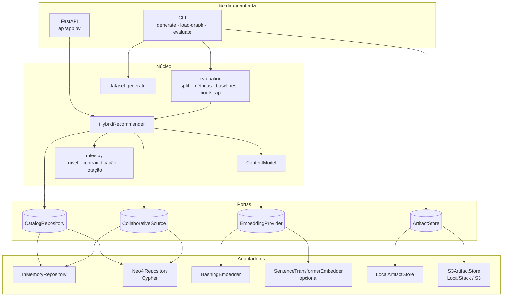
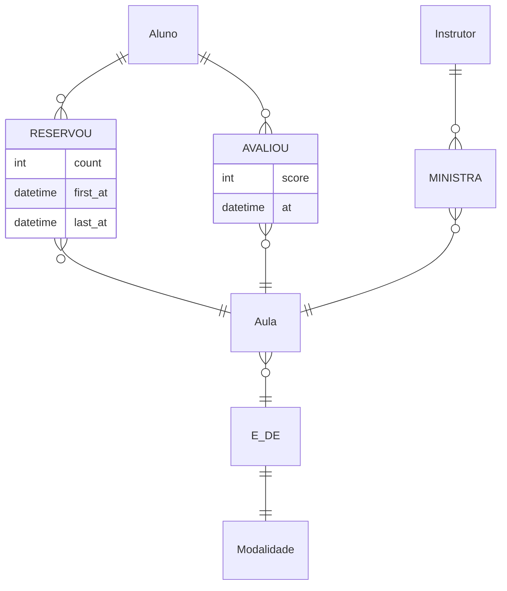
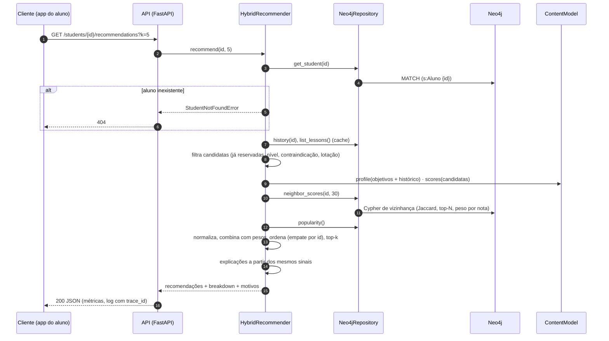
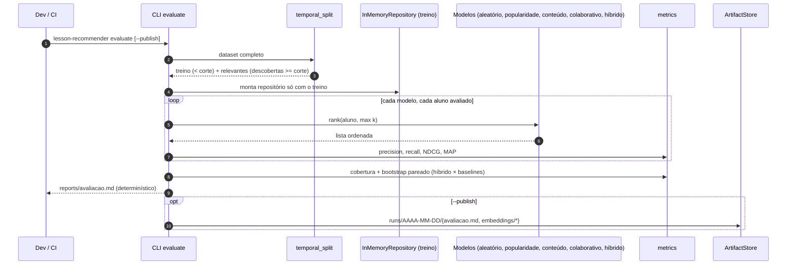

# Design doc: lesson-recommender

- Autor: Johnny Santos
- Status: fundação implementada
- Última revisão: 2026-11-21

## 1. Contexto

O ecossistema de portfólio tem um SaaS multitenant de agendamento para estúdios de yoga e
pilates (projeto `saas-multitenant`). O domínio é fictício. Alunos reservam aulas recorrentes
da grade: modalidade, nível, instrutor, horário e intensidade. Hoje o aluno encontra aulas
novas navegando pela grade inteira. Estúdios relatam o padrão de sempre: o aluno se prende a
uma ou duas aulas, enjoa e cancela o plano.

O lesson-recommender sugere a cada aluno **aulas que ele ainda não faz**, combinando com seus
objetivos, com aulas parecidas com as que ele frequenta e com o que alunos parecidos
frequentam. As regras do estúdio são inegociáveis: nada de aula lotada, fora do nível ou
contraindicada. Cada recomendação vem com o motivo.

## 2. Objetivos e não-objetivos

**Objetivos da fundação**

1. Gerador de dataset sintético reprodutível, com padrões plantados (sinal real a aprender).
2. Grafo no Neo4j (`Aluno`, `Aula`, `Instrutor`, `Modalidade`; `RESERVOU`, `AVALIOU`,
   `MINISTRA`, `É_DE`), com carga idempotente e colaborativo por vizinhança em Cypher.
3. Recomendador híbrido (conteúdo por embeddings + colaborativo + popularidade), com regras de
   negócio como filtros e pesos configuráveis.
4. **Avaliação offline como núcleo:**
   - split temporal;
   - precision, recall, NDCG, MAP e cobertura;
   - baselines, ablações e IC por bootstrap;
   - relatório reprodutível.
5. API `GET /students/{id}/recommendations?k=` com explicação.
6. Observabilidade (logs JSON, Prometheus, OpenTelemetry), CI com lint, tipos, testes e build.

**Não-objetivos (por ora)**

- Integração em tempo real com o `saas-multitenant`, que hoje é carga em lote a partir do
  dataset.
- Multitenancy no recomendador: um estúdio por instância.
- Teste A/B, métricas online e aprendizado contínuo.
- Treino de modelos pesados (ALS, learning to rank) e GPU.
- Autenticação na API. Ela fica atrás da plataforma de entrada (`platform-edge`), que cuida de
  JWT e rate limit.

## 3. Arquitetura

Arquitetura hexagonal (ADR 0001). O núcleo conhece só portas; adaptadores de memória, Neo4j,
embeddings e storage ficam na borda; `bootstrap.py` faz a composição.

| Componente | Responsabilidade |
|---|---|
| `domain/` | Entidades imutáveis, regras de negócio, portas e erros |
| `recommender/` | Conteúdo, colaborativo de referência, candidatas, combinação híbrida e explicações |
| `adapters/memory_repository.py` | Catálogo e colaborativo sobre um `Dataset` (testes, avaliação, API sem Neo4j) |
| `graph/` | Cypher, carga em lotes e repositório Neo4j |
| `embeddings/` | Hashing determinístico e sentence-transformers opcional |
| `evaluation/` | Split temporal, métricas, baselines, runner com bootstrap e relatório |
| `artifacts/` | Porta de storage e publicação versionada por data |
| `api/`, `bootstrap.py`, `observability.py` | HTTP, composição e telemetria |

## 4. Modelo de dados

### Domínio

- **Aula** (`Lesson`):
  - id, título, modalidade, instrutor, nível (`livre`, iniciante, intermediário, avançado);
  - dia da semana, horário, duração, intensidade (1 a 5);
  - capacidade e vagas ocupadas;
  - descrição, focos (objetivos que trabalha) e contraindicações.
- **Aluno** (`Student`): id, nome, nível concreto, objetivos (flexibilidade, fortalecimento,
  redução do estresse, postura, condicionamento, reabilitação) e restrições (gestante, lesão
  lombar, hipertensão, lesão no joelho).
- **Reserva** (`Booking`): aluno, aula, data e hora. Repetições são normais (a mesma aula toda
  semana).
- **Avaliação** (`Rating`): nota de 1 a 5, com data.

### Grafo (Neo4j)

(No banco, a relação se chama `É_DE`. O diagrama usa `E_DE` porque o Mermaid não aceita acento
em identificadores.)

- Há constraints de unicidade em `id` para os quatro rótulos.
- `RESERVOU` é agregada (uma aresta por par, com contagem), e `AVALIOU` guarda a nota mais
  recente.
- A carga usa `MERGE` em lotes `UNWIND` de 1000 linhas, então é idempotente.

### Dataset sintético

`dataset/generator.py` (ADR 0006), com seed 42:

- 80 aulas, 400 alunos, 12 instrutores e 7 modalidades;
- 26 semanas, cerca de 15 mil reservas e 1,6 mil avaliações.

Padrões plantados:

- objetivos × foco;
- tribos latentes (instrutores, modalidades e período favoritos);
- período do dia;
- descoberta gradual;
- notas correlacionadas com a afinidade.

## 5. Fluxos principais

### 5.1 Recomendação online

### 5.2 Avaliação offline

### 5.3 Carga do ambiente (docker-compose)

O fluxo é `neo4j` (healthy) e `localstack` (healthy, o script de init já criou o bucket), depois
`seed`, que gera o dataset, carrega o grafo, avalia e publica no S3 local. Por fim sobe a `api`.
Cada etapa espera a anterior com `depends_on` + `condition`.

## 6. Falhas e como são tratadas

| Falha | Comportamento |
|---|---|
| Aluno inexistente | `StudentNotFoundError`, que vira 404 com mensagem clara |
| `k` fora de 1..50 ou não numérico | 422 (validação FastAPI e `InvalidRequestError` no domínio) |
| Nenhuma aula elegível | 200 com lista vazia; incrementa `lr_empty_recommendations_total` |
| Aluno sem histórico (cold start) | Conteúdo pelos objetivos + popularidade; colaborativo zera e a explicação não o menciona |
| Neo4j indisponível na subida | `verify_connectivity` falha e o processo não sobe (o orquestrador reinicia) |
| Neo4j cai depois da subida | A exceção do driver vira 500 e aparece no log JSON com trace_id. Retry e circuit breaker ficam nos próximos passos |
| Configuração inválida (peso negativo, backend desconhecido, extra ausente) | Falha na subida com `ValueError` ou `ConfigurationError` explicando a correção |
| Dataset ausente ou com schema de versão diferente | CLI sai com código 1 e log de erro; a API não sobe |
| Chave de artefato maliciosa (`../`) | `ValueError`; nada é escrito |
| Sinal constante entre candidatas | A normalização devolve 0 em vez de dividir por zero |

## 7. Segurança

- **Dados:** domínio e dataset 100% sintéticos. Nomes inventados, nenhum dado pessoal real.
- **Restrições de saúde** (gestante, lesões) são dados sensíveis num cenário real. Aqui elas só
  **excluem** aulas e nunca aparecem nas explicações nem nos logs. Os logs registram o id do
  aluno, não o perfil.
- **Segredos:**
  - credenciais só por variáveis de ambiente (`SecretStr` no pydantic, nunca logadas);
  - valores de desenvolvimento marcados como `dev-only-*`;
  - `.env` no `.gitignore`.
- **Cypher sempre parametrizado** (`$student_id`), sem concatenação de strings, o que evita
  injeção.
- **Entrada validada na borda:** `student_id` com 1 a 64 caracteres e `k` entre 1 e 50, o que
  limita o custo por requisição.
- **Imagem:** multi-stage, usuário sem privilégios (uid 10001), sem ferramentas de build no
  runtime.
- **Autenticação e autorização:** delegadas à plataforma de entrada (projeto `platform-edge`).
  Em produção, o aluno só pode pedir as próprias recomendações; o id viria do JWT, não da URL.

## 8. Observabilidade

| Sinal | Implementação |
|---|---|
| Logs | JSON em stdout (`observability.JsonFormatter`): ts, nível, logger, mensagem, `trace_id`/`span_id` quando há span ativo e campos de contexto (rota, status, duração, aluno, k, retornados) |
| Métricas | `/metrics` em formato Prometheus: `lr_http_requests_total{route,method,status}`, `lr_http_request_duration_seconds`, `lr_recommendations_total{dominant_signal}`, `lr_empty_recommendations_total` |
| Traces | OpenTelemetry SDK, com span `recommend` (atributos `student.id`, `recommendation.k`, `recommendation.count`). Exporta via OTLP HTTP quando `LR_OTEL_EXPORTER_OTLP_ENDPOINT` está definido; `make up-all` liga o Jaeger |
| Qualidade do modelo | Relatório offline versionado no Git e publicado por data no S3 local |

`lr_recommendations_total{dominant_signal}` acompanha qual sinal domina as recomendações
servidas. Se a popularidade passar a dominar, provavelmente o grafo está vazio ou desatualizado.

## 9. Alternativas consideradas

Os detalhes estão nos ADRs:

- **Fatoração de matrizes e LTR no lugar do híbrido linear** (ADR 0003 e 0007): menos
  explicáveis e mais caros de operar na fundação.
- **Só sentence-transformers** (ADR 0002): CI pesado e não determinístico.
- **PostgreSQL no lugar do Neo4j** (ADR 0003): autojunções em vez de travessia.
- **Split aleatório ou leave-one-out** (ADR 0004): vazamento temporal.
- **Regras como penalidade** (ADR 0005): inseguro.
- **LocalStack** foi rejeitado no ADR 0008 por peso e adotado no ADR 0010, porque a imagem do servidor anterior saiu dos registros públicos.

## 10. Plano de evolução

1. **Validação temporal separada** para ajustar pesos e o número de vizinhos sem tocar no
   teste.
2. **Protocolo de cold start** (alunos novos) e métricas por segmento: nível, modalidade e
   alunos com restrição.
3. **sentence-transformers medido** no mesmo relatório; carregar o índice publicado no S3 local
   na subida da API.
4. **Ingestão de eventos do `saas-multitenant`** (reservas e ocupação em tempo quase real), o
   que torna a regra de lotação confiável.
5. **GDS Node Similarity em lote** para vizinhos pré-computados; cache de recomendações por
   aluno com invalidação na reserva.
6. **Diversidade e novidade** como métricas e como re-ranqueamento (MMR), e limite de
   exposição por aula para não lotar turmas.
7. **A/B online** com métrica de negócio (reservas originadas da recomendação) e guardrails.
8. **Resiliência:** retry com backoff e circuit breaker no Neo4j, fallback para popularidade em
   cache.
